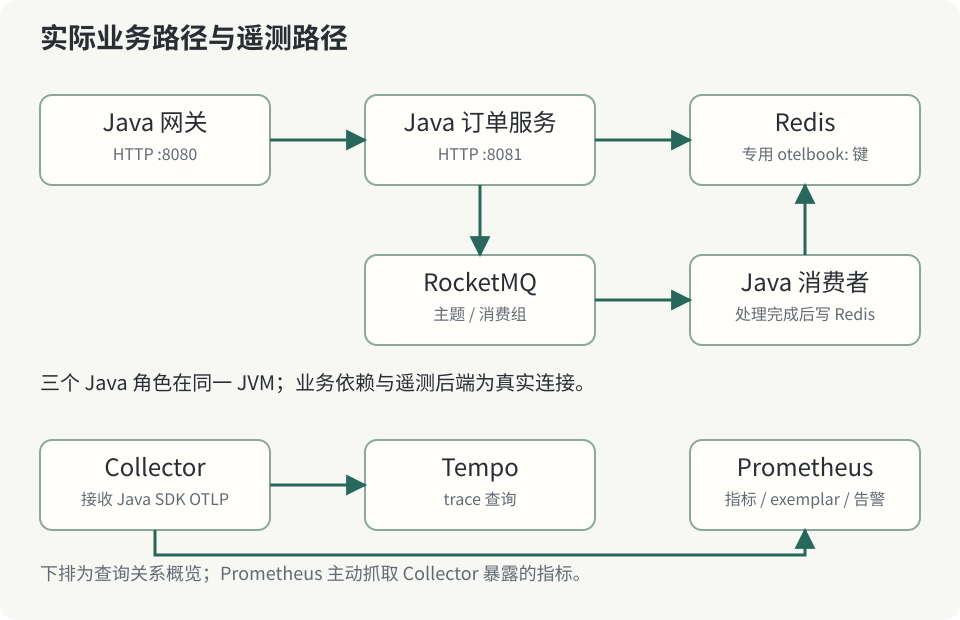

# 第 2 章：搭建一套能被独立核查的小系统



一张架构图只展示了作者想表达的连接，不能证明这些连接真实发生。我们的实验先启动实际依赖，再执行 Java 程序，最后通过后端查询验证遥测。某个环节缺失时，验收应当失败，而不是由程序自己打印“已发送 trace”就结束。

## 2.1 运行边界与版本基线

Java 21 运行一个入口网关、订单 HTTP 服务和 RocketMQ 消费者。它们共用进程，是为了把环境成本集中在传播、采集和查询上；三个 `Telemetry` 实例分别设置 `book-gateway`、`book-orders`、`book-worker`。网关通过真实 Java HttpClient 访问 8081，订单服务通过 Jedis 访问 Redis，再通过经典 Remoting 客户端发布 RocketMQ 消息。

容器栈包含 Redis 7.2.5、RocketMQ 5.3.2、Collector Contrib 0.111.0、Tempo 2.6.1 与 Prometheus 2.55.1。Java SDK 固定为 OpenTelemetry 1.55.0，Jedis 固定为 5.2.0。`book/image-lock.json` 保存镜像清单摘要，Compose 在标签后同时写入摘要。标签方便人阅读，摘要约束实际拉取内容；升级时仍须重新执行验收。

这些组件不需要都向宿主机开放。实验仅把读者操作和验收用的端口绑定到 `127.0.0.1`。Prometheus 使用 9095，避免与常见的 9090 服务冲突。Collector 在容器网络里向 Tempo 的 OTLP gRPC 4317 导出，宿主 Java 则使用 Collector 的 HTTP 4318。相同数字在不同网络命名空间中，并不意味着同一个监听器。

## 2.2 一次完整运行

在本书根目录准备 JDK 21、Maven 与 Docker Compose：

```sh
mvn -f lab/pom.xml --batch-mode --no-transfer-progress package
bash lab/run_ci.sh
```

脚本先创建独立 Compose project，等待 Broker 能够创建主题，检查 Redis PING，再启动 Java 应用。Java 只有在 Redis 可连接、生产者与消费者已经初始化后才暴露健康入口。随后 Python 验收程序提交场景请求，查询实际 Tempo 与 Prometheus。退出时脚本只清理本实验 project 的容器和卷，并停止自己启动的 Java 子进程。

不要把脚本中的端口改成指向已有生产依赖。Redis 键使用 `otelbook:` 前缀，实验不会执行 FLUSHALL；RocketMQ 使用专用主题与消费组。这些约束降低误混数据的概率，但不替代你在运行前检查 Compose project 与监听端口。

## 2.3 分开检查“已启动”与“可交付”

容器状态为 running 只能说明入口进程尚未退出。Broker 可能还没有注册，Collector 可能因为配置错误而拒绝遥测，Tempo 也可能处于查询未就绪阶段。因此脚本用带超时的重复查询等待业务条件，而不是固定睡眠三秒后假设环境准备完毕。

验收还保留反例：消息业务成功但上下文断开、采样为零但指标继续出现。只有正例的测试容易把网络、库配置或查询误解掩盖掉。运行产物应当记录返回内容、版本、镜像和提交；当代码改变时，需要新的运行证据。

本地没有容器运行时的读者可以查看仓库 Actions 的 `observability-evidence` artifact。它证明对应提交在 CI 环境的行为，不代表你的电脑也已经完成部署。

**练习。** Collector 的 4318 可连接、Prometheus 的 `up` 为 1，是否足以证明网关请求已进入 Tempo？写出至少两个仍可能失败的环节，并指出应查询哪个接口验证。

RocketMQ Docker 启动与 Broker 对外地址可对照 [官方快速开始](https://rocketmq.apache.org/docs/quickStart/02quickstartWithDocker/)。
