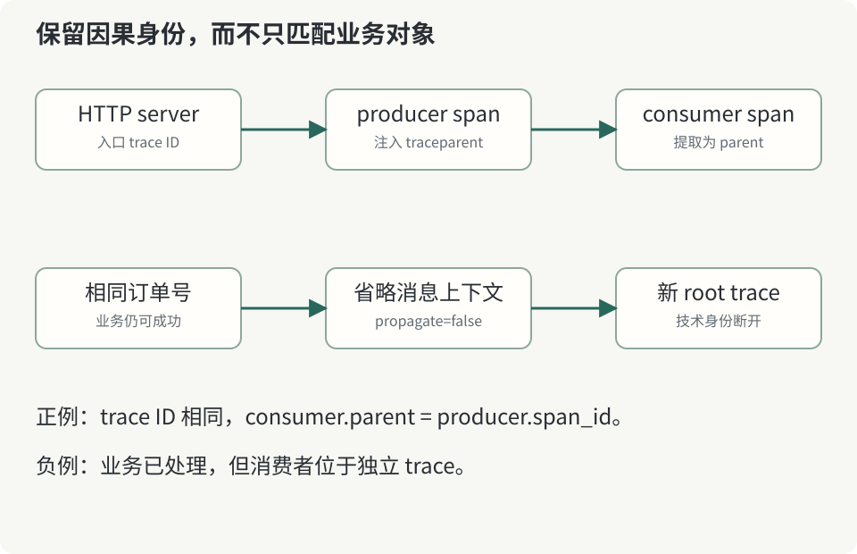

# 第 6 章：消息成功送达，追踪为什么仍会断开



同步 HTTP 调用很容易让人把上下文传播理解成“调用栈里的变量”。消息跨过队列后，生产者与消费者可能相隔很久，也可能运行在不同进程。消费者线程不会因为业务上处理了同一条消息，就自动拥有生产者的 Context。

## 6.1 先区分三种身份

订单号标识业务对象，消息 ID 标识一次消息投递相关的技术对象，trace ID 标识一次因果执行。它们不应互相替代。一个订单可能产生创建、支付、取消等事件，一个事件也可能被重投；如果只靠订单号聚合执行，就无法区分独立读取和重试。

实验在 producer span 成为当前上下文后，把 W3C 字段注入 RocketMQ message user properties。消费者从 MessageExt 取回这些字段，以提取结果创建 CONSUMER span。应用 JSON 保留订单号与受控消费等待参数，消息协议字段保留技术上下文，两者职责分开。

验收要求 consumer 的父 span ID 等于 producer 的 span ID，并且三个服务的 span 出现在同一个 trace 中。只检查 trace ID 相等还不够，因为一个错误的上下文选择也可能保留 ID，却把工作挂到错误的父节点。

## 6.2 一个刻意保留的负例

向 `/orders` 提交：

```json
{"id":"broken-context","propagate":false}
```

订单依然写入 Redis，消息依然被 RocketMQ 消费，消费者依然写入结果。差异是消费者没有可提取的技术上下文，于是创建新的根 trace。验收通过 `worker.processed` 事件取得第二个 trace ID，再分别查询两个 trace，证明业务成功与追踪连续性是两个独立属性。

这个负例在真实系统里很常见：某条旧消息格式没有属性透传，转发服务只复制正文，或者框架更换了属性名。排查时若只看“消息没有积压”，会完全错过可观测性断点。反之，看到断点也不能立即断言消息丢失。

## 6.3 父子、link 与业务等待

本书采用单消息、单处理者的 parent-child 表达，适合展示最小因果链。批量消费、聚合多条消息、长期任务或多次重投时，一个工作区间可能有多个输入来源；span link 比强行挑一个父节点更能保留这些关系。选择表达方式应基于业务语义与所用框架约定，不要把单例代码当作所有消息系统的统一标准。

`worker_delay_ms` 会使 consumer span 持续变长，而入口仍可能很快返回 202。这个实验帮助我们区分 HTTP 接受延迟与异步完成延迟。若真实业务承诺“订单必须在一分钟内完成”，还要设计从业务事件时间到处理完成时间的 SLI，不能用入口 p95 代替它。

消费者示例在异常时返回 RECONSUME_LATER，没有实现完整业务幂等事务，也没有验证所有 Broker 故障窗口。这里关注的是每次处理是否有正确因果身份；业务重投语义仍应按消息系统和应用约束单独测试。

**练习。** 一个消费者把十条来自不同 trace 的消息聚合成一次写入，应该怎样表达这些来源？请画出一种 link 方案，再说明把十个 trace ID 拼成新的业务 trace ID 会丢失哪些语义。

消息属性与消费行为可从 [RocketMQ 官方文档](https://rocketmq.apache.org/docs/)继续核查；上下文的作用范围见 [OpenTelemetry 传播文档](https://opentelemetry.io/docs/concepts/context-propagation/)。
